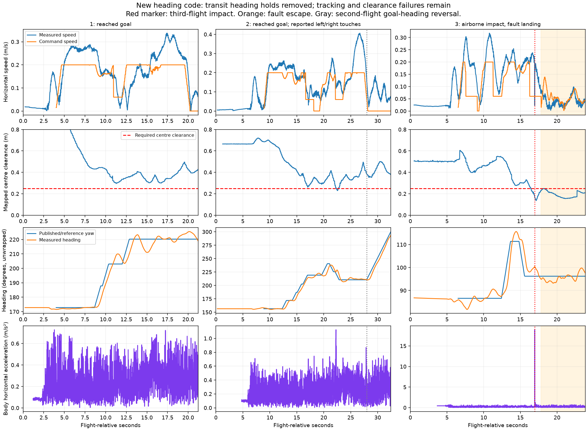
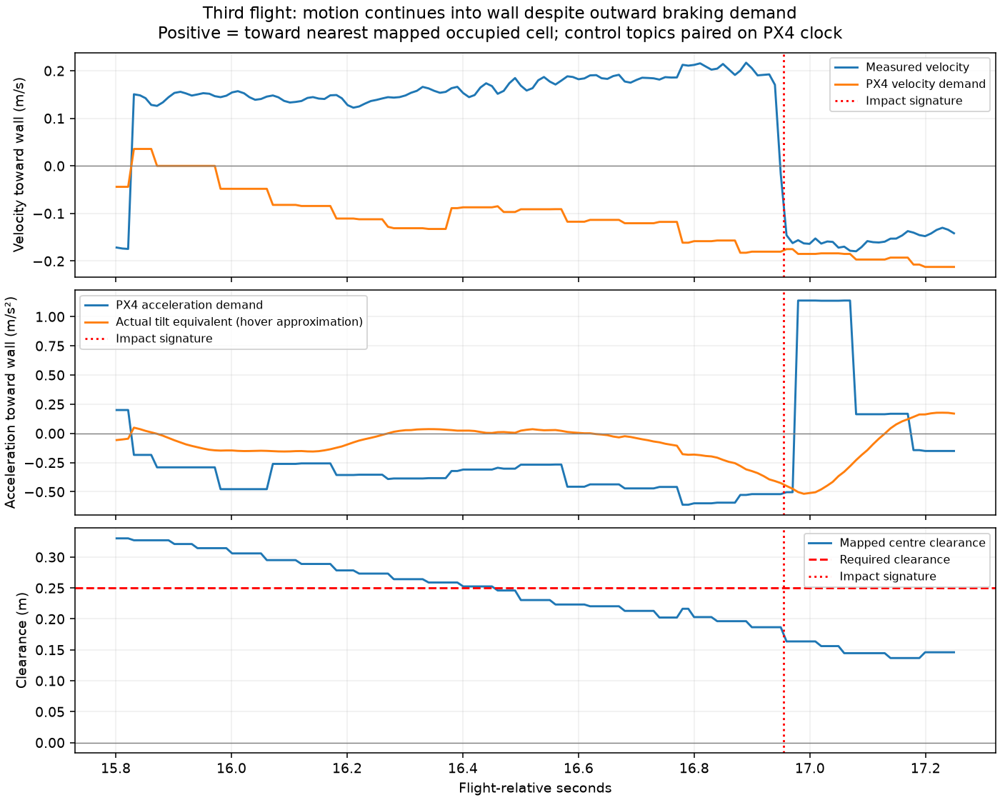

# Three flights after heading continuity change, 2026-09-08

**Transit heading alignment improved, but the aircraft still overruns lateral
braking commands.** All three flights used the new C++ settings (35 cm heading
preview, 20 deg/s reference slew). There were **zero yaw-alignment hold ticks
before first reaching the goal**, or throughout the unsuccessful third route.
Reference changes stayed within 1 degree per ordinary 50 ms tick.

The third flight has a strong airborne impact signature, followed by an
unsuccessful clearance escape and fault-timer landing. The second's reported
left/right touches are consistent with its lateral excursions, but its onboard
acceleration does not provide distinct impact timestamps. It also exposes a
separate goal-heading fallback problem after first reaching the goal.

## Recordings and outcomes

| Flight | ROS bag suffix | Matching SD ULog | Outcome |
|---|---|---|---|
| 1 | `20260908T032407Z` | `19_17_34.ulg` | Goal reported at 19.25 s; land command at 21.20 s |
| 2 | `20260908T032454Z` | `19_18_22.ulg` | User reports left then right contact; first goal at 27.25 s, land command at 32.45 s |
| 3 | `20260908T032636Z` | `19_20_03.ulg` | Impact signature at 16.95 s; no goal; land command at 23.86 s |

Retrieved from `/fs/microsd/log/2026-09-05/` to
`ros2_ws/flight_logs/px4_<name>.ulg`. Sizes match SD: **2,338,052**, **3,054,454**,
and **3,113,092 bytes**; all three have **zero ULog dropouts**. The vehicle was
disarmed before retrieval. The SD date is incorrect; pairing uses PX4 boot
timestamps. Boot-seconds to analysis-time offsets are -190.470727457,
-235.196311145 and -336.961392677 respectively.

The third MCAP has a truncated final record; its earlier data and the complete
ULog cover the impact and landing decision. Times here use the earliest selected
topic from `analyze_yaw_tracking.py`, not elapsed time since arming.

## Second flight: leftward then rightward excursions

- Around **16.5 s**, body-left speed is about **0.14 m/s**. The nearest mapped
  clearance falls to approximately **0.27 m** around 16.9 s. The follower first
  degrades during map-correction settling, then reports a 0.16 m cross-track
  excursion at 17.20 s. The adapter holds from 18.15 to 19.25 s before recovering.
- Around **21.5–22.0 s**, body-right speed is approximately **0.08–0.10 m/s**.
  Cross-track exceeds its limit again at 22.10 s; mapped clearance reaches
  **0.230 m at 22.50 s**, inside the configured 0.250 m requirement. The follower
  reports `CLEARANCE_ESCAPING` during this episode.
- At **21.5 s**, actual velocity toward the nearest mapped wall is **0.168 m/s**,
  against **0.033 m/s** PX4 demand. Acceleration demand is already **0.547 m/s²
  away** from that wall while actual tilt is equivalent to **0.083 m/s² toward**
  it. At 22.0 s, velocity demand points away while measured velocity still points
  toward the wall.

These are approach/overshoot windows, **not proven contact times**. The only
large horizontal acceleration spike in this ULog occurs at 33.64 s, after
disarming, near ground level. Gentle brushing need not produce a distinct body
acceleration impulse. The map also has finite resolution and localization error;
0.27 m mapped clearance does not refute the user's observed touch.

## Third flight: impact before the fault landing

| Time | Evidence |
|---|---|
| 16.21 s | `CROSS_TRACK_EXCEEDED`, approximately 0.08 m; adapter begins degraded ride-out |
| 16.51 s | Follower reports `CLEARANCE_ESCAPING`, start clearance about 0.23 m |
| 16.50 s | Measured wallward velocity **+0.169 m/s**, PX4 demanded velocity **-0.091 m/s**; acceleration demand **-0.268 m/s²**, actual tilt equivalent **+0.024 m/s²** |
| 16.85 s | Measured wallward velocity **+0.214 m/s**, demanded velocity **-0.157 m/s** |
| 16.95 s | **18.93 m/s² body-horizontal acceleration impulse**, OFFBOARD, armed, z about **-0.299 m**; nearby mapped centre clearance **0.164 m** |
| 17.81 s | Degraded grace expires; fault HOLD and bounded clearance escape begin |
| 23.86 s | Follower remains invalid; six-second fault timer requests landing |

Positive wallward quantities point toward the closest occupied grid-cell
square, not simply toward the aircraft's right. Map geometry is paired causally
with PX4 data. Control demand and response themselves are paired on the onboard
clock. Tilt-equivalent acceleration assumes near-hover vertical thrust; it is
not measured translational acceleration.

The attitude log independently supports delayed/insufficient corrective response:
at about **16.5 s**, roll target is **-2.89 degrees**, measured roll **-0.02
degrees**; target roll rate is **-12.35 deg/s**, measured rate approximately
**-0.03 deg/s**. During 16.0–16.9 s, roll tracking RMS error is 2.28 degrees and
roll-rate RMS error 8.39 deg/s. Peak motor command in that window is **0.660**,
so recorded command saturation does not explain the miss. Physical delivered
torque, RPM and per-motor current remain unmeasured.

During fault HOLD, the escape controller keeps placing a target roughly 5 cm
away from the current position. It fails to restore the required clearance;
the recorded minimum during 18.0–23.7 s is about 0.155 m. The `escaping` text
means an admissible command was being generated, not that clearance was
improving. Position changes and integrated estimated velocity also differ after
impact, so this period is unsuitable for estimating a clean braking model.

No yaw-alignment hold occurs in this third flight. VIO feature count stays
above the configured threshold during the route; its later reset sentinel
appears around 29 s, **after** landing was requested. It is not the trigger for
the DNF. Healthy feature count alone does not prove accurate odometry.

## Separate defect: heading turns back after goal arrival

Second flight:

1. Goal first reported at **27.25 s**. The aircraft continues past it.
2. At **27.64 s**, a short replacement route points back toward the goal.
   Its command reaches the end; debug progress is the full 0.060 m path length.
3. Initially `preview_deg` is null and reference remains -149.55 degrees.
4. At **27.99 s**, aircraft-to-standing-target displacement crosses the
   **0.15 m `yaw_track_min_displacement` threshold**. The non-advancing fallback
   in `PathCommandLimiter::preview_direction()` points the nose back toward that
   target, producing a **19.30-degree goal**, a **168.73-degree alignment error**.
5. Once the aircraft gets closer again, preview becomes null, but the retained
   heading goal continues the turn. Reference reaches approximately -59.55
   degrees before landing: about 90 degrees of unnecessary rotation.

This is the standing-position-target fallback, not the earlier short-leg
point-tangent discontinuity. Spatial preview only runs on advancing motion,
so it does not affect this branch. The previous implementation work preserved
that fallback and missed this terminal-state case. Reference slew bounds the
turn rate but does not cancel an inappropriate goal.

The goal-hold phase still executes route-command updates. A terminal hold needs
explicit heading ownership: preserve arrival heading through goal overshoot and
recovery, and do not interpret a stationary position correction as a new travel
heading. This is separate from the lateral tracking problem in the tunnel.

## Battery and limits of the findings

At sampled battery current >20 A:

| Flight | Median loaded pack voltage | Minimum loaded pack voltage |
|---|---:|---:|
| 1 | 10.951 V | 10.689 V |
| 2 | 10.864 V | 10.572 V |
| 3 | 10.762 V | 10.135 V |

These differ from the charged hover's approximately 11.24 V median. They do not
rule out a power contribution or establish battery as the cause. No gains,
power-system configuration or control parameters were changed in this analysis.

## Next work

The user has deferred terminal heading retention. See
[TUNNEL_BRAKING_20260908.md](TUNNEL_BRAKING_20260908.md) for the deeper rate-loop
trace and the subsequent fix to the abrupt degraded-mode velocity cap.

1. Measure repeatable translation/braking response in open space, in both
   lateral directions, from a settled hover and with recorded loaded voltage.
   The third flight shows that a geometrically cleared command and near-aligned
   yaw do not bound the aircraft's wallward motion.
2. Use that response envelope for measured-velocity stopping/clearance checks
   and continuous velocity/acceleration through path joins and corners.
   Merely widening the yaw or cross-track gates would not address these events.

Artifacts: `scripts/analyze_heading_flights_20260908.py` extracts the three bags
offline into `reports/heading_flights_20260908_bags.json`. Per-flight onboard
control CSV/JSON and second/third-flight attitude-window JSON are under
`reports/heading_flights_<HHMMSS>_*`. No flight-control code was changed during
this analysis; the existing heading implementation remains the flown version.
