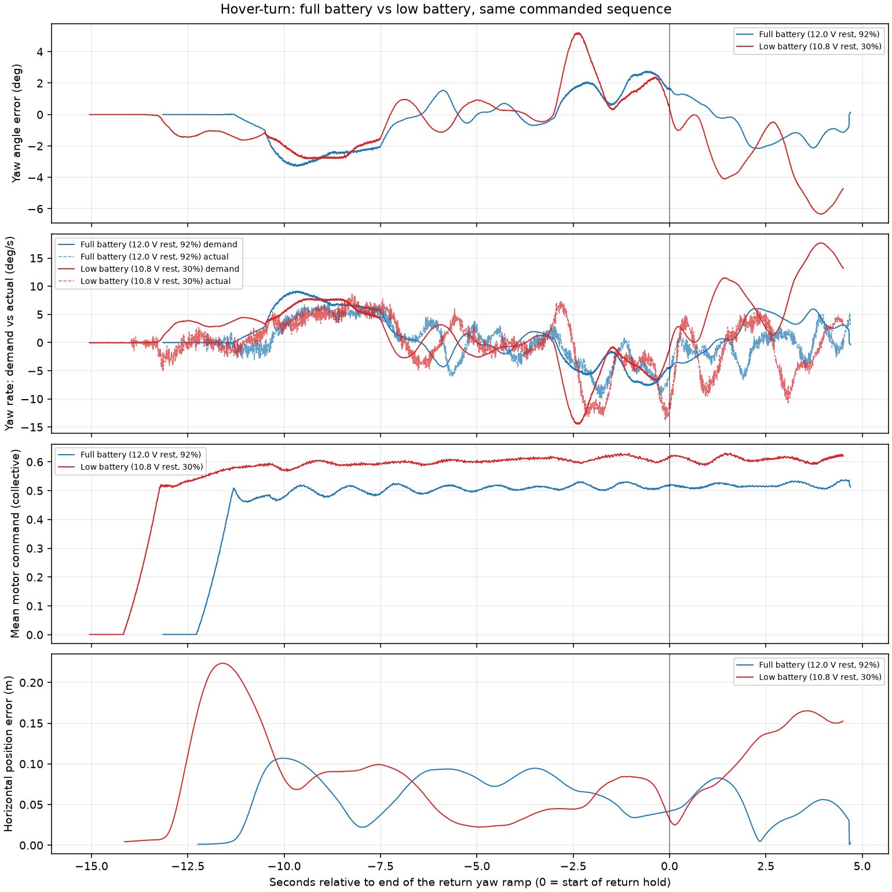

# Hover-turn: full battery vs low battery, 2026-09-07

**The same commanded sequence flown on a full pack tracks roughly three times
better in the return hold.** The hold deterioration reported in
`HOVER_TURN_20260907.md` is largely, though not entirely, a function of pack
state. The yaw-lag signature that produced it is still present on the full
pack; it is contained rather than absent.

## The two flights

| | Full battery | Low battery |
|---|---|---|
| Rosbag | `offboard_hold_yaw_20260907T093157Z` | `offboard_hold_yaw_20260907T085348Z` |
| ULog | `px4_01_35_38.ulg` (2,246,299 B, size matched, 0 dropouts) | `px4_00_58_16.ulg` (2,623,755 B, 0 dropouts) |
| Rested voltage | 11.94 V | 10.76 V |
| `remaining` at arm → land | 0.977 → 0.921 | 0.304 → 0.145 |
| Minimum loaded voltage | 11.00 V (3.67 V/cell) | 9.70 V (3.23 V/cell) |
| Battery warning code | 0 throughout | reached 1 (low) |
| Airborne duration | 17.97 s to AUTO.LAND | 19.69 s |

Both logs carry the same 19 topics and the same commanded sequence
(0.30 m, 15° at 5°/s, 5 s holds). Hover current was comparable on both
(≈32–38 A), so the difference is pack voltage under load, not a different
power demand.

## Thrust margin

| | Full battery | Low battery |
|---|---:|---:|
| Mean collective, airborne | **0.512** | **0.606** |
| Peak motor command, airborne | 0.640 | 0.803 |
| Collective drift over the flight | flat (0.50 → 0.52) | rising (0.545 → 0.621) |
| Arm → 0.29 m | **4.29 s** | **6.81 s** |

The low-battery run hovered at 0.606 collective and climbed steadily as the
pack sagged; the full-battery run held 0.51 flat. Neither run clipped a motor
during the holds, so this is a difference in *remaining differential
authority*, not in saturation.

## Hold quality, matched windows

Windows are the 3 s starting 1.0 s after each yaw ramp ends, so both flights
are measured at the same phase of the sequence.

| Return hold | Full battery | Low battery |
|---|---:|---:|
| Median XY position error | **4.4 cm** | **13.7 cm** |
| Peak XY position error | 8.3 cm | 16.5 cm |
| Yaw angle error RMS | **1.48°** | **3.68°** |
| Yaw angle error peak | 2.17° | 6.34° |
| Yaw rate error RMS | **4.96°/s** | **12.68°/s** |
| Mean yaw rate demand | +3.57°/s | +9.15°/s |
| Mean measured yaw rate | −0.56°/s | −1.49°/s |
| Mean yaw torque demand | 0.034 | 0.080 |
| Motor pair ratio (0,1)/(2,3) | 1.139 | 1.304 |
| Roll rate error RMS | 3.38°/s | 5.06°/s |
| Z error RMS | 0.7 cm | 1.2 cm |

Aligned on the end of the return yaw ramp, the two flights track each other
closely through takeoff, the outbound turn, the first hold and the return
ramp. They separate only after the return hold begins.

## The yaw disturbance is still there

Both flights show the same signature in the final seconds: yaw error goes
negative, PX4 demands a positive yaw rate, and yaw torque and motor-pair ratio
climb together.

| Seconds before land | Full: τ_z / pair / yaw err | Low: τ_z / pair / yaw err |
|---|---|---|
| −3 | 0.026 / 1.105 / −0.83° | 0.040 / 1.143 / −1.36° |
| −2 | 0.037 / 1.152 / −1.75° | 0.065 / 1.237 / −3.28° |
| −1 | 0.043 / 1.181 / −1.50° | 0.130 / 1.546 / −5.72° |

On the full pack the aircraft arrests the negative yaw rate (measured rate
returns to +0.99 and +0.29°/s) and the error stops growing. On the low pack it
never recovers and the divergence accelerates into the landing. So the pack
state decides whether the controller *contains* the disturbance; it does not
explain where the disturbance comes from. A persistent yaw torque bias of the
same sign is present on a fully charged pack.

## One result that got worse

The **first** hold was better on the low-battery flight: 2.8 cm median XY error
versus 8.8 cm on the full pack. The full-battery error is a steady offset, not
a wobble — median 8.8 cm, peak 9.4 cm, peak speed 0.061 m/s — and it decays
over the following seconds (9.1 cm at 7 s, 4.5 cm at 12 s, 3.9 cm at 13 s).
The faster climb (4.3 s rather than 6.8 s) reaches the hold before the position
integrator has converged. This is consistent with an unconverged integrator; the
logs do not prove that attribution.

## What this does and does not settle

Established: pack state is a first-order term in hold quality on this airframe.
Return-hold position error fell 3.1x and yaw rate error 2.6x with no parameter
change, and hover collective fell from 0.606 to 0.512.

Not established: that the wall strikes were caused by the battery. Those were
translating flights, and this test holds a fixed horizontal setpoint. The
missed-braking finding in `WALL_STRIKES_20260907.md` stands on its own
measurements. What this adds is that both strike flights were flown with the
same reduced authority, which would plausibly worsen a braking shortfall.

Not established: the source of the yaw torque bias. RPM, per-motor current and
ESC limiting are still unlogged, so a disturbance, an actuator asymmetry and
rate-loop tuning cannot be separated from these recordings.

## Next

1. Fly all further control tests above ~3.7 V/cell loaded, and record pack
   state with every run. Comparisons across different pack states are not
   like-for-like.
2. Re-run the wall-strike scenario on a full pack before changing gains, so
   the braking shortfall is measured at full authority.
3. The yaw torque bias is worth a props-off bench check of motor direction and
   mounting before it is treated as a tuning problem.
