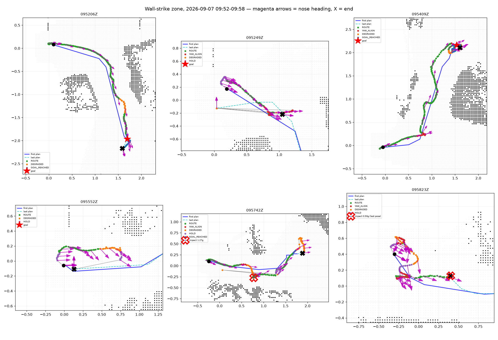

# Wall-strike zone, six runs on healthy packs, 2026-09-07 09:52–09:58

**Battery is ruled out, and the dominant failure is a heading gate that stops
translation at every route corner sharper than 40°.** Two of the six runs ended
in a mid-air contact. Both were runs whose commanded heading reversed.

## The six runs

| Bag | ULog | Pack (rested / remaining) | Outcome |
|---|---|---|---|
| `095206Z` | `px4_01_55_11` | 12.13 V / 0.82→0.65 | goal reached, no contact |
| `095249Z` | `px4_01_55_53` | 11.70 V / 0.70→0.61 | failed — RTABMap reset sentinel, no contact |
| `095409Z` | `px4_01_57_14` | 11.72 V / 0.69→0.51 | goal reached, no contact |
| `095552Z` | `px4_01_58_57` | 11.68 V / 0.61→0.53 | failed — RTABMap reset sentinel, no contact |
| `095742Z` | `px4_02_00_44` | 11.87 V / 0.56→0.47 | goal reached, **contact at 15.6 s, 12.4 m/s² (1.27 g)** |
| `095823Z` | `px4_02_01_27` | 11.52 V / 0.45→0.49 | no progress, **contact at 25.7 s, 9.1 m/s² (0.93 g)** |

All six flew above the 3.7 V/cell threshold from
`HOVER_TURN_BATTERY_COMPARE_20260907.md`, so pack state does not explain these.
Both contacts are airborne: z = −0.29 m and −0.31 m, nav_state OFFBOARD, several
seconds before AUTO.LAND. Every other >5 m/s² event in the six logs is a
touchdown (z ≈ 0, during AUTO.LAND, immediately before disarm).

## Why it goes left, then turns and goes right

The commanded heading is an **instantaneous** path tangent. `advance_tangent()`
takes a 1e-4 m forward difference at the previewed progress
([command_limiter.cpp:653](ros2_ws/src/px4_vio_bridge/src/command_limiter.cpp#L653)),
so crossing a route vertex steps the yaw target by the whole corner angle. The
adapter then latches `YAW_ALIGN` at `yaw_align_error_deg = 40.0` and pauses
translation outright, resuming only below 15°.

Yaw-target steps of 10° or more, per run:

| Run | Steps ≥10° | Largest | Crossed the 40° gate |
|---|---:|---:|---|
| `095206Z` | 2 | +39° | no |
| `095552Z` | 3 | +22° | no |
| `095249Z` | 2 | +44° | **−40°, then +44° 3.5 s later** |
| `095409Z` | 10 | −72° | −63°, −72° |
| `095742Z` | 7 | +104° | **+41°, then −45° 0.4 s later**, +104° |
| `095823Z` | 5 | −70° | −70° |

`095742Z` is the clearest case: the target went 95° → 136° → 91° in 0.4 s. The
vehicle stopped, began turning one way, and the target reversed before the turn
finished. `095249Z` did the same over 3.5 s (132° → 92° → 136°). That reversal
is the "turns and then goes rightwards" you saw.

Neither run that kept every step under 40° thrashed. `095552Z` flew its route
cleanly at the full 0.20 m/s until an unrelated VIO reset ended it.

## The stop is self-sustaining

`max_cross_track` is **0.08 m**. The full-battery hover test measured a
horizontal hold error of 4.4 cm median and 8.3–9.4 cm peak in still air with a
fixed setpoint. **The follower's cross-track limit is smaller than the
airframe's own hold error.** So a translation pause reliably trips it:

pause → vehicle drifts to its normal hold error → `CROSS_TRACK_EXCEEDED` →
new follower generation → planner republishes → tangent moves → new yaw hold.

`095823Z` spent **42% of the flight in YAW_ALIGN** and closed only 0.68 m of a
2.06 m goal distance in 24 s, cycling through follower generations 113→130.
Measured drift during individual yaw holds was 0.09–0.17 m net.

## What the vehicle was actually doing at each contact

| | `095742Z` @15.6 s | `095823Z` @25.7 s |
|---|---|---|
| Speed | 0.11 m/s | 0.08 m/s |
| Velocity direction vs nose (crab) | **60° → 93°** | **−52° → −72°** |
| Commanded vx | +0.11 → +0.18 m/s | −0.21 → −0.23 m/s |
| Actual vx | −0.11 m/s | +0.10 → +0.05 m/s |
| Nearest known occupied cell | **0.22 m** | 0.37 m (last pose, 1.7 s before) |
| Follower state | `CLEARANCE_ESCAPING` | `FOLLOWING` |

Both contacts happened while the vehicle was translating **30–93° away from
where its nose pointed**, with PX4 commanding velocity opposite to the actual
motion — the same missed-braking signature as `WALL_STRIKES_20260907.md`. In
`095742Z` the obstacle was **already in the map** and the follower already knew
it was inside the clearance band; it could not get out in time.

## On decoupling travel direction from heading

Your instinct is right, and the data is stronger than the proposal: **the
vehicle already translates off-heading, by up to 93°.** The nose-forward gate
does not prevent off-heading motion. It forbids *commanded* off-heading motion
and leaves *uncommanded* drift — which is unplanned, not speed-limited, and not
clearance-checked along the direction it actually travels. That drift is what
hit the wall in both runs.

I tested your "as long as it is already mapped" condition directly. At each yaw
hold I probed 0.6 m along the intended travel direction against the grid of that
moment:

| Run | Hold | Duration | Ahead 0.6 m known | Free | Min clearance |
|---|---|---:|---|---|---:|
| `095249Z` | 14.47 s | 1.6 s | yes | yes | 0.52 m |
| `095249Z` | 17.97 s | 1.3 s | yes | yes | 0.47 m |
| `095409Z` | 13.26 s | 2.8 s | yes | yes | 0.33 m |
| `095823Z` | 17.32 s | 3.1 s | yes | yes | 0.62 m |
| `095742Z` | 13.20 s | 0.2 s | yes | yes | **0.04 m** |
| `095823Z` | 9.57 s | 2.1 s | **no** (unknown at 0.20 m) | yes | 0.52 m |
| `095823Z` | 11.87 s | 0.9 s | **no** (unknown at 0.35 m) | yes | 0.43 m |

**Four of seven holds paused the aircraft over ground that was already mapped
free with 0.33–0.62 m of clearance.** Those stops bought nothing and cost the
drift that restarted the cycle. The three exceptions define the guard you need:
two were genuinely turning toward unmapped space, and one was already 4 cm from
an obstacle.

### What I would change

1. **Make the yaw target a lookahead-averaged tangent** over the next
   0.3–0.5 m of path, not a 1e-4 m derivative. This removes the step at every
   corner and would have prevented the +41°/−45° reversal in `095742Z` outright.
   Cheapest fix, largest effect, and it does not touch the safety argument.
2. **Rate-limit and hysteresis the yaw target** so a replan cannot reverse it.
   A target that moves 41° and back in 0.4 s is a route change to be rejected,
   not a heading to chase.
3. **Replace the hard stop with a clearance-gated crab allowance.** Permit
   translation at large yaw error when the swept corridor — vehicle radius plus
   tracking error plus stopping distance — is known and free in the current grid
   for the braking distance ahead. Cap crab-mode speed below aligned speed,
   since the camera is not looking there.
4. **Keep nose-forward only where that corridor is not known-free**, so
   `095823Z`'s two early holds still turn before moving. That preserves the real
   safety case for a forward-facing camera.
5. **Raise `max_cross_track` above the measured hold error**, or gate it on
   commanded motion. At 0.08 m it is below the airframe's own 0.083–0.094 m peak
   hold error, so it fires on noise whenever translation is paused.

Item 5 is the one I would do first alongside item 1: together they break the
stop→drift→replan loop without changing any safety envelope.

## Still open, not addressed by any of the above

- **Missed braking.** At both contacts the commanded velocity opposed the actual
  motion. Permission to crab does not fix that; it needs the stopping-trajectory
  work.
- **VIO resets.** Two of six runs died on `INVALID_VIO reason=RTABMap reset
  sentinel` with no contact involved. Separate perception failure.
- `095823Z`'s bag is truncated (0-byte `metadata.yaml`, short final MCAP record),
  so its contact is 1.2 s past the last recorded pose. The ULog covers it; the
  bag does not.
