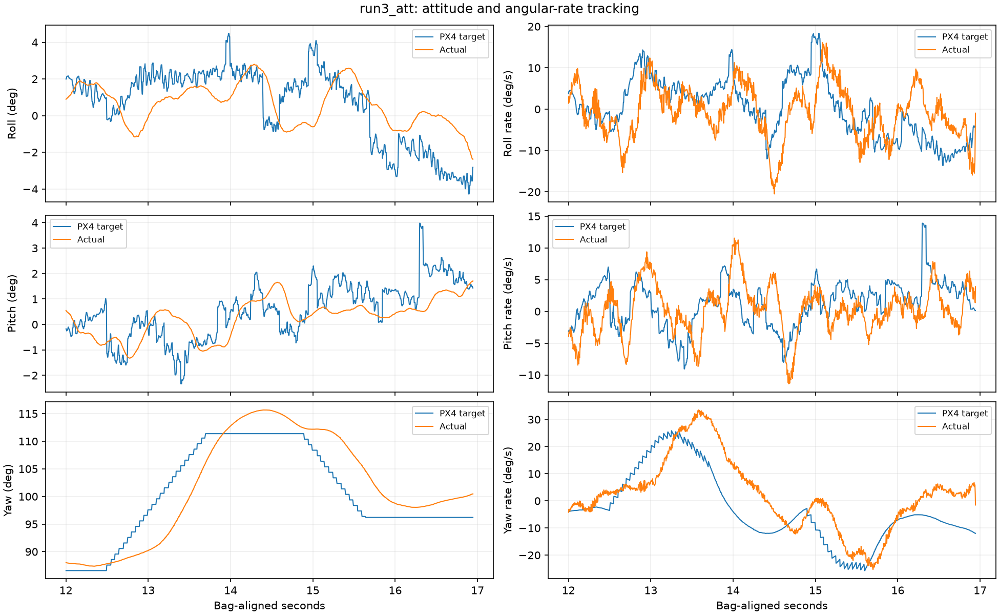

# Runs 2 and 3: braking response and degraded-command discontinuity

This follow-up prioritizes the tunnel failures. Terminal heading retention is
deferred at the user's request. The flight timeline, battery measurements and
map-clearance qualifications are in [HEADING_FLIGHTS_20260908.md](HEADING_FLIGHTS_20260908.md).

## What the evidence establishes

Run 2 approaches opposite walls while corrections lag the lateral motion. Its
reported left/right touches cannot be individually timestamped from acceleration.
Run 3 has a clear airborne impact at 16.95 s, followed by unsuccessful clearance
recovery and fault-timer landing. Wallward motion precedes the degraded transition
in both runs. Neither terminal heading behavior nor the later VIO reset explains
those approaches.

The commanded braking is not promptly realized. In run 3 at 16.5 s, velocity
toward the nearest mapped wall is approximately +0.17 m/s while PX4 requests
about -0.09 m/s. The mapped clearance then crosses inside the 0.25 m requirement.
The adapter checks the pose-to-command segment; it does not check where measured
velocity will carry the aircraft during control delay and braking. Thus a cleared
target can coexist with an impending strike.

## Further tracing of the rate loop

Torque and gyro are now matched by **identical `timestamp_sample`**, with a
causally preceding rate target no older than 10 ms. This avoids assigning a
single rapidly changing gyro sample to an arbitrary bag-time instant.

Run 3, 100 ms averages:

| Window (s) | Roll-rate request (deg/s) | Measured (deg/s) | Published roll torque | Inferred integral contribution |
|---|---:|---:|---:|---:|
| 16.1–16.2 | -3.39 | +2.91 | -0.0075 | +0.0137 |
| 16.2–16.3 | -6.81 | +7.16 | -0.0243 | +0.0118 |
| 16.5–16.6 | -11.60 | -0.91 | -0.0208 | +0.0070 |
| 16.8–16.9 | -8.70 | -8.33 | +0.0086 | +0.0037 |

The roll loop responds to the negative error, but achieved rate briefly has the
opposite sign and subsequently catches up. The inferred positive integral term
is unwinding; it partially offsets proportional braking. That is **not sufficient
evidence of integrator windup**: an integral term can also compensate steady load
or trim, and the logs lack direct allocator status and delivered motor torque.
Recorded motor commands remain below saturation in the pre-impact window.

The reconstruction uses `torque = P*error + integral - D*angular_acceleration +
FF*rate_target`, verified against the
[exact running PX4 source](https://raw.githubusercontent.com/PX4/PX4-Autopilot/d6f12ad1c4f70ad3230afd7d86e971421e02fef4/src/lib/rate_control/rate_control.cpp).
For run 3, 9–16.95 s, 1,556 exact sample pairs are available. The median absolute
disagreement between successive inferred roll-integral changes and the
unsaturated integral update is 0.0000073 normalized torque; p99 is 0.0000503.
This is a consistency check, not a substitute for recording `rate_ctrl_status`.
Yaw is excluded because its published torque has an additional low-pass filter.



These observations justify investigating roll/pitch response. They do not yet
select a gain change or distinguish controller tuning, motor/ESC response,
external disturbances and power effects. The inner rate loop affects position
tracking as described in the [PX4 tuning guide](https://docs.px4.io/main/en/config_mc/pid_tuning_guide_multicopter#rate-controller).

## A concrete adapter defect fixed

On entering `DEGRADED`, the requested 0.06 m/s crawl was applied as an
instantaneous state clamp after the acceleration-limited update. This bypassed
the configured 0.30 m/s² bound. The separately published acceleration feedforward
was clipped, so it did not match the sudden velocity change.

| Run | Time (s) | Velocity-reference step (m/s) | Difference / receipt interval (m/s²) |
|---|---:|---:|---:|
| 2 | 16.645 | approximately 0.14 | 2.95 |
| 2 | 22.150 | approximately 0.13 | 2.32 |
| 3 | 16.263 | 0.14 | 2.70 |

At run 3's transition, NED velocity changes from `(0.0634, 0.1897)` to
`(0.0190, 0.0569)` m/s in 51.9 ms. The adapter's nominal 50 ms interval implies
2.8 m/s². These are command-reference derivatives, not physical acceleration.

`PathCommandLimiter` now treats a reduced cap as the desired rate. Both on-path
motion and an active rejoin approach it through the acceleration bound instead
of clamping the resulting state. At 20 Hz, a straight cruise-to-crawl transition
is `0.185, 0.170, …, 0.065, 0.060` m/s over ten updates. Zero caps brake to rest,
and releasing a cap accelerates normally. Recorded configuration now identifies
`speed_cap_transition: acceleration_limited`.

**Scope:** this fixes a demonstrated transition defect, not a demonstrated cause
of the initial wallward drift. In run 3, reducing the cap also removed some
already-away-pointing lateral velocity feedforward. A smooth transition avoids
that abrupt loss, but a closed-loop comparison is needed to measure its effect.
The new straight-path reference advances about **2.9 cm farther** during the
first 0.5 s than the old instantaneous crawl. The existing chord-clearance gate
still validates each resulting command; it does not guarantee stopping clearance.

Other discontinuities remain: run 2 has approximately 0.9–1.0 m/s² command-vector
changes around 20.84, 21.39 and 21.84 s. Polyline corners and join completion can
change direction abruptly; scalar speed limiting is not a complete vector
acceleration/jerk constraint. Map-to-PX4 rebasing can also move the position
reference independently of velocity feedforward. The comments claiming complete
derivative consistency have been corrected. This patch does not claim to fix
these other transitions.

## Validation and next step

Three regression cases failed before the implementation change and pass after:
cruise-to-crawl on a straight path, an active rejoin, and zero-cap braking/release
with varying time steps. The invalid-cap test also passes. The package was built
and installed. Full package validation, followed by rerunning the C++ target after
updating its old instantaneous-cap expectation: **603 tests, 0 errors, 0 failures,
3 skipped**. Python syntax checks and `git diff --check` pass. Build/test logs are
`/tmp/degraded_fix_build.log`, `/tmp/degraded_fix_tests.log` and
`/tmp/degraded_final_tests.log`. This is software validation, not flight validation.

Next physical test: a short, fixed-heading translation-and-stop in both lateral
directions from a settled hover, with loaded voltage and rate-loop/allocator
telemetry recorded. Measure velocity reversal delay, displacement after braking
starts, attitude/rate tracking and repeatability. A stationary hover/yaw test does
not exercise this failure. Do not infer a calibrated stopping envelope from the
post-impact escape phase.

Then use the measured response to design a stopping-clearance check driven by
actual velocity, and a reference generator that bounds the full velocity and
acceleration vectors through joins/corners. Enlarging cross-track tolerance or
changing yaw gates alone cannot bound the observed lateral motion.

Reproduction (from repository root):

```bash
source /opt/ros/jazzy/setup.bash
source ros2_ws/install/setup.bash
python3 scripts/analyze_command_continuity.py ros2_ws/flight_logs/offboard_global_20260908T032636Z --start 9 --end 16.95 --out reports/run3_command_continuity
.venv-mavlink/bin/python3 scripts/analyze_rate_loop.py ros2_ws/flight_logs/px4_19_20_03.ulg --time-offset=-336.961392677 --start 9 --end 16.95 --out reports/run3_rate_loop
```

Both analyzers are offline. No live PX4 parameters, logging configuration, arming
state or flight sequence were changed during this follow-up.
