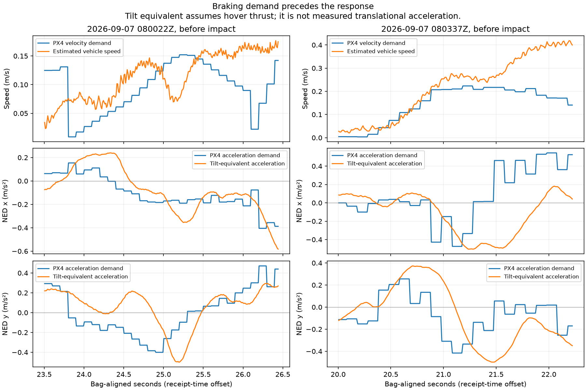

# Wall strikes: measured control response and first mitigation

Follow-up: [the completed open-area hover-turn test](HOVER_TURN_20260907.md)
reproduced poor rate tracking during a fixed-position hold. The expanded
logging is active; the three previously missing topics were captured.

The aircraft does not follow the demanded braking closely enough near these
strikes. This is **not established as a position-setpoint chase at excessive
demanded speed**. The new yaw slowdown reduces the planner's demand before a
turn; it is a mitigation, not proof that the wall strikes are resolved. The
hold drift in the first flight remains an open control/estimation problem.

## New evidence

Downloaded the two matching onboard logs, rather than reconstructing the
controller's output from ROS feedforward alone:

| ROS flight | PX4 SD log | Local copy |
|---|---|---|
| 20260907T080022Z | `/fs/microsd/log/2026-09-05/00_06_11.ulg` | `ros2_ws/flight_logs/px4_20260907_080022.ulg` |
| 20260907T080337Z | `/fs/microsd/log/2026-09-05/00_09_26.ulg` | `ros2_ws/flight_logs/px4_20260907_080337.ulg` |

The SD clock is more than two days behind the host. Pairing uses the PX4 boot
timestamps in the bag's local-position messages, checked against the recorded
motion. File sizes match the SD listing (4,054,500 and 3,325,957 bytes). The
first ULog has two dropouts; the second has none. The second bag is truncated;
its recoverable MCAP data was used directly. ROS vehicle-status decoding fails
with the current message definition, so it is not used for this comparison.

Times below are relative to the earliest topic read by
`analyze_yaw_tracking.read()` with its default topic set. They differ slightly
from the previous handoff's time origin. Controller demand and response are
paired causally on the **onboard clock**, with maximum ages of 200 ms for the
10 Hz demand stream and 50 ms for attitude. The bag receipt-time offset only
labels the horizontal axis; it does not introduce a relative lag between them.

| Flight / pre-impact window | Peak actual speed | PX4 demanded speed at that instant | Peak demanded speed anywhere in window |
|---|---:|---:|---:|
| 080337Z, 20.00–22.23 s | **0.419 m/s** | **0.141 m/s** | 0.223 m/s |
| 080022Z, 23.50–26.45 s | 0.177 m/s | 0.142 m/s | 0.152 m/s |

These are `vehicle_local_position_setpoint.vx/vy`, **after** PX4 adds position
feedback and constrains velocity, against `vehicle_local_position.vx/vy`.
The earlier claim that both events were driven by twice-cruise demand is not
supported. Actual speed alone also misses the first event's wrong direction.

In 080337Z at about 21.50 s, the NED-x acceleration demand is already
**+0.46 m/s²**, but the actual tilt is equivalent to about **−0.49 m/s²** of
horizontal thrust at hover. X velocity continues negative, reaching about
−0.42 m/s before contact. In 080022Z, during HOLD at about 24.70 s, Y demand
is **−0.33 m/s²** while tilt is equivalent to **+0.18 m/s²**. Later, Y velocity
remains around −0.16 m/s while braking demand is positive, and the route
restarts before that drift has settled.



Tilt-equivalent acceleration is computed from the recorded quaternion and a
near-hover thrust assumption. It is **not measured translational acceleration**
and cannot distinguish attitude-loop response, disturbances, and estimator
effects by itself. The evidence locates a response mismatch; it does not yet
justify changing attitude or rate gains, motor geometry, or VIO calibration.

## Corrections to the previous proposed fix

Read the running firmware identity over NSH: PX4 1.17.0,
`d6f12ad1c4f70ad3230afd7d86e971421e02fef4`. Its
[position controller](https://github.com/PX4/PX4-Autopilot/blob/d6f12ad1c4f70ad3230afd7d86e971421e02fef4/src/modules/mc_pos_control/PositionControl/PositionControl.cpp)
adds position feedback to velocity feedforward, then runs velocity PID plus
acceleration feedforward. The acceleration output is bounded through thrust
and tilt constraints; `MPC_ACC_HOR_MAX` is not a general bound on this raw
offboard feedback output. The
[module wiring](https://github.com/PX4/PX4-Autopilot/blob/d6f12ad1c4f70ad3230afd7d86e971421e02fef4/src/modules/mc_pos_control/MulticopterPositionControl.cpp)
also distinguishes the trajectory generator from the offboard setpoint input.

- A 0.30 m/s `MPC_XY_VEL_MAX` would not bind the demanded velocities in either
  pre-impact window. It is a demand ceiling, not a guarantee on actual speed.
- `MPC_ACC_HOR_MAX=1.0` is not the proposed offboard braking guarantee.
- YAW_ALIGN already brakes along the accepted path at the command acceleration;
  it does **not** instantly zero translation. The wire velocity remains nonzero
  through the onset in the second flight. The threshold is late, but describing
  this as an instantaneous freeze was inaccurate.
- Average roll alone cannot rule out transient attitude response or external
  lateral forces. Map/path metrics do not prove physical propeller clearance.

No PX4 flight-control parameters were changed. Removing the hard yaw stop or
raising travel speed is not supported by this evidence.

### Why the earlier impacts were specifically on the right

Follow-up after the hover test: project the onboard NED vectors onto the
aircraft's instantaneous right axis, `(-sin(heading), cos(heading))`. Positive
means body-right; negative means body-left. This is **not an exact wall-normal
projection**, particularly while the nose is misaligned with a bend.

| Flight / t | Body-right actual velocity | Body-right demanded velocity | Body-right acceleration demand | Body-right tilt-equivalent acceleration |
|---|---:|---:|---:|---:|
| 080337 / 21.50 s | +0.145 m/s | +0.091 m/s | **−0.456 m/s²** | **+0.611 m/s²** |
| 080337 / 22.10 s | +0.356 m/s | +0.066 m/s | −0.229 m/s² | −0.049 m/s² |
| 080022 / 24.90 s | −0.135 m/s | +0.116 m/s | +0.437 m/s² | +0.094 m/s² |
| 080022 / 26.40 s | +0.160 m/s | +0.005 m/s | **−0.167 m/s²** | **+0.067 m/s²** |

080337 shows a rightward departure during the bend: the controller is already
requesting a leftward acceleration while the aircraft still tilts right. The
rightward velocity then grows despite the braking request. 080022 has a
different lead-in: leftward drift during HOLD prompts a rightward recovery;
the resulting rightward motion persists as the controller brakes it and the
route resumes. Thus the side of impact follows these particular motion and
recovery histories, not evidence of a universal right trim.

The subsequent hover test supports the existence of poor closed-loop tracking
with fixed horizontal commands; its late drift was leftward relative to the
initial heading. It cannot independently establish the right-wall geometry or
identify why the aircraft failed to deliver the earlier braking demand. The
power/actuator/tuning explanation remains unresolved.

## Implemented change

C++ `yaw_slowdown` defaults to true in the node and launch. Between the existing
15° resume error and 40° hold error, translation's target ceiling tapers
linearly from cruise to zero. At 30° error it settles to **0.08 m/s** for the
0.20 m/s cruise. Its ceiling decreases by no more than `command_acceleration *
dt` per tick; at 20 Hz the first ceiling from cruise is 0.185 m/s, avoiding an
instantaneous jump to the lower target.

The existing yaw hold/hysteresis still operates. A follower dropout's stricter
speed cap still wins. Yaw slowdown does not freeze path replacement, and the
final command still passes the existing clearance/geofence checks and rollback.
The current path limiter's separate corner/join discontinuities and fault-hold
behavior are not redesigned by this change. `yaw_slowdown:=false` restores the
prior yaw behavior. The legacy Python adapter is unchanged.

Built from `ros2_ws/`; **610 tests, 0 errors, 0 failures, 3 skips**, plus two
offline analysis regressions. New C++ regressions cover early braking, speed
recovery, left/right symmetry, disabled alignment, the stricter follower cap,
and the retained hard hold. These validate software behavior, not physical
collision avoidance. No flight was launched.

## Logging and the remaining fix

The custom SD logger configuration omitted `vehicle_attitude_setpoint`,
`vehicle_rates_setpoint`, and `vehicle_angular_velocity`. Added all three at
5 ms intervals and read back the file. Original contents are saved locally in
[`reports/logger_topics_before_20260907.txt`](reports/logger_topics_before_20260907.txt).
The attempted long-name SD backup failed; the local backup is the rollback
source. The new logging configuration should be loaded after the next PX4
reboot. No logger restart or reboot was issued during this work.

The next validation needs a short controlled hover/low-speed turn with physical
clearance outside the tunnel, including a settled hold. Compare attitude target
to attitude, rate target to angular rate, and torque/motor outputs. This is what
can distinguish ordinary attitude lag from rate tracking trouble or a
disturbance/estimation problem. Resolve the hold drift before treating the
planner mitigation as sufficient for another tunnel attempt.

## Reproduce the measured comparison

```bash
.venv-mavlink/bin/python3 scripts/analyze_control_response.py \
  ros2_ws/flight_logs/px4_20260907_080337.ulg \
  --time-offset=-354.830179623 --start 20 --end 22.23 \
  --out reports/wall_strike_080337
.venv-mavlink/bin/python3 scripts/analyze_control_response.py \
  ros2_ws/flight_logs/px4_20260907_080022.ulg \
  --time-offset=-160.822074584 --start 23.5 --end 26.45 \
  --out reports/wall_strike_080022
.venv-mavlink/bin/python3 -m unittest discover -s scripts \
  -p test_analyze_control_response.py
```

The CSVs contain paired demand, velocity, tilt equivalent, raw acceleration,
heading, and demand age. The JSONs record the windows, metrics, relevant
onboard parameters, dropout counts, and missing control topics.
