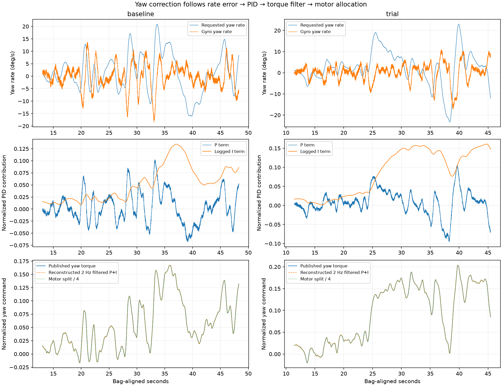

# Growing yaw correction: software chain checked, physical response still open

The current evidence localizes the unexplained behavior beyond a simple extra
command inserted by the planner, rate controller or allocator. It does **not**
identify a defective motor. No motors were spun and no gains, output mappings,
ESC calibration or ESC firmware settings were changed during this investigation.
Roll-rate P remains at the restored 0.150 baseline.

User-reported hardware: **BLHeli 30 A ESCs, 1700 KV motors, 6-inch propellers**.
Exact motor/ESC variants, prop pitch/blade count, guard clearance and actual ESC
firmware settings remain unspecified. Do not infer DShot or telemetry support
from the BLHeli name alone.

## What the recordings establish

The analysis uses the paired baseline `20_22_29.ulg` and trial `20_51_29.ulg`.
`scripts/analyze_yaw_motor_chain.py` matches torque and gyro on exact sample
timestamps and uses fresh causal rate-target/integrator matches. At the flown
firmware, yaw torque is rate P plus logged I (yaw D/FF are zero), followed by a
2 Hz first-order filter. The logged I is updated just after torque calculation;
subsampled logging also omits intermediate controller iterations. The offline
reconstruction is therefore approximate, not a bit-exact firmware replay.

- Filtered P+I matches published yaw torque with **99th-percentile absolute
  residual below 0.00085** in baseline and **0.00071** in trial, in normalized
  command units. This leaves no large unexplained additive yaw command.
- `(motor[0]+motor[1]-motor[2]-motor[3])/4` matches published yaw torque almost
  exactly: median absolute residual about **1.5e-8** in both flights. The motor
  split is the expected allocation of the yaw command, not an independently
  discovered bad-motor measurement.
- During the trial's first five maneuver seconds, mean yaw I is **0.010** and
  mean published torque **0.0043**. During its last five seconds, mean I is
  **0.147** and torque **0.156**. The final bias is largely accumulated rate-error
  correction. I is below its 0.30 clamp; allocator clipping was absent.
- The yaw filter time constant is approximately **79.6 ms**. It delays changes
  but has unity steady-state gain; it does not independently generate the growing
  DC offset. This is not evidence that the filter is optimally tuned.

These equations are checked against the exact firmware's
[rate controller](https://raw.githubusercontent.com/PX4/PX4-Autopilot/d6f12ad1c4f70ad3230afd7d86e971421e02fef4/src/lib/rate_control/rate_control.cpp),
[yaw filtering call](https://raw.githubusercontent.com/PX4/PX4-Autopilot/d6f12ad1c4f70ad3230afd7d86e971421e02fef4/src/modules/mc_rate_control/MulticopterRateControl.cpp),
[filter implementation](https://raw.githubusercontent.com/PX4/PX4-Autopilot/d6f12ad1c4f70ad3230afd7d86e971421e02fef4/src/lib/mathlib/math/filter/AlphaFilter.hpp)
and [rotor effectiveness equation](https://raw.githubusercontent.com/PX4/PX4-Autopilot/d6f12ad1c4f70ad3230afd7d86e971421e02fef4/src/modules/control_allocator/VehicleActuatorEffectiveness/ActuatorEffectivenessRotors.cpp).



## Heading consistency

Integrating gyro-derived Euler yaw rate, including measured roll/pitch coupling:

| Flight window | Integrated gyro yaw change | Estimated attitude yaw change | Difference |
|---|---:|---:|---:|
| Baseline, 13.06–48.30 s | -3.49° | -2.62° | +0.87° |
| Trial, 11.43–45.45 s | +4.30° | +4.73° | +0.43° |

This weakens a hypothesis of large sustained artificial heading drift driving
the correction. It does not rule out estimator delay, transient corrections that
cancel over a window, or shared sensor errors. The trial integration interpolates
across a recorded 73.7 ms gyro gap; there is no independent motion-capture truth.
External-vision yaw also varies in the onboard recordings. A fixed command is
not a claim that physical yaw was constant.

## Live output/configuration audit

PX4 was disarmed. Raw snapshots:
[rotors/PWM](reports/yaw_motor_live_20260908.txt),
[PX4IO/yaw/bias status](reports/yaw_backend_live_20260908.txt).

- Actual motor backend is **PX4IO MAIN PWM**, functions 101–104 on MAIN 1–4.
  The `pwm_out` module is the separate AUX backend and has no assigned motors.
- MAIN timer rates read 400 Hz. All four motor ranges are minimum 1100, maximum
  1900 and disarmed 1000 microseconds, with no output reversals configured.
- Rotor count is four; all axes point body-up, CT values match, and the diagonal
  pairs have opposite yaw-moment signs. This matches the intended X geometry.
- DShot is not running and `esc_status` has never published. There is no logged
  per-motor RPM, temperature or delivered-torque measurement to verify physical
  achievement. PX4 PWM endpoints do not reveal the ESCs' learned endpoints.
- The yaw gains, 2 Hz filter, rotor geometry and MAIN PWM configuration match
  the successful July 26 `05_23_55.ulg`. That does not establish that the physical
  airframe, props or ESC settings remained unchanged. It does make an inadvertent
  recent change to those PX4 settings a weaker explanation.

The recorded PWM outputs broadly follow the motor commands, with no clipping in
the prior audit. Causal log pairing is imperfect (roughly 3–5 microseconds median
absolute discrepancy from the nominal `1100+800*u` mapping); it is not a scope
measurement at the ESC connector or proof of actual rotor response.

## Prepared physical check — not executed

The remaining distinction needs observations of the aircraft. Start by recording
each prop's markings, handedness and installed location. With propulsion power
disconnected, remove **all four props** and inspect for rub marks, loose mounts,
shaft play or binding. Label removed props so a mismatch is not lost during
disassembly. Prop removal is required by
[PX4's actuator-test procedure](https://docs.px4.io/v1.17/en/config/actuators#actuator-testing).

After the user confirms props are off and the aircraft is ready, reconnect USB
and propulsion power, keep the flight launch stopped, and verify `commander
status` says Disarmed. The planned test is one motor for two seconds at normalized
0.05, then stop and record the observation before testing another. This is a
startup/direction check, not a loaded thrust test or an ESC calibration.

Expected physical mapping, **viewed from above with the nose forward**:

| Test motor | Log index | MAIN output | Position | Expected rotation |
|---|---:|---:|---|---|
| 1 | 0 | 1 | Front right | Counterclockwise |
| 2 | 1 | 2 | Rear left | Counterclockwise |
| 3 | 2 | 3 | Front left | Clockwise |
| 4 | 3 | 4 | Rear right | Clockwise |

Prepared first command, **only after the above physical setup**:

```bash
cd /home/john/autonomous_drone_px4_vio
.venv-mavlink/bin/python3 scripts/nsh.py 'actuator_test set -m 1 -v 0.05 -t 2'
```

The syntax and bounded timeout were checked using the live help command and
[exact firmware implementation](https://raw.githubusercontent.com/PX4/PX4-Autopilot/d6f12ad1c4f70ad3230afd7d86e971421e02fef4/src/systemcmds/actuator_test/actuator_test.cpp).
No `set` or `iterate-motors` command has been sent. If a motor does not start at
this low value, record that outcome; do not jump to a high output or declare the
motor faulty from that alone. For each motor record physical location, direction,
whether startup is smooth, and any rubbing/stutter. Do not use `iterate-motors`:
it runs automatically and is less useful for recording one observation at a time.

If mapping and low-speed behavior pass, the next evidence needed is a readout of
the four ESCs' actual firmware/settings (especially matching input calibration,
timing, startup and braking settings) through a supported programming interface.
Those have not been read or altered here. A props-off pass cannot exclude a
load-dependent motor/ESC/prop problem. Additional gain changes or asserting a
particular failed component are not justified by the present evidence.

Artifacts: `reports/yaw_motor_chain_20260908.json/.txt/.png`; reproducible with
`.venv-mavlink/bin/python3 scripts/analyze_yaw_motor_chain.py` (redirect stdout
for `.txt`). Python compilation and `git diff --check` pass.
