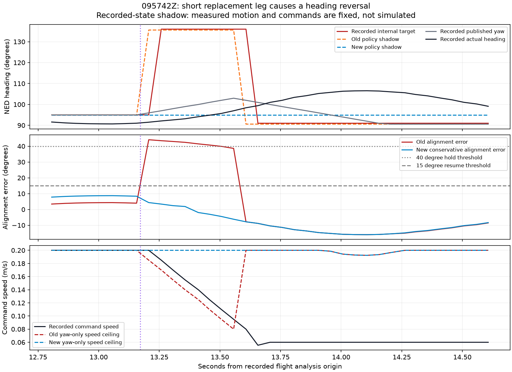

# Heading reversal diagnosis and implementation, 2026-09-08

> Flight follow-up: [HEADING_FLIGHTS_20260908.md](HEADING_FLIGHTS_20260908.md).
> Three new flights confirm no transit yaw-alignment holds, but wallward
> braking/clearance failures remain. A separate terminal heading fallback
> causes an unnecessary turn after goal overshoot in the second flight.

The 095742Z reversal is reproduced from recorded geometry: a replacement
introduced a short diagonal first leg, then command progress crossed its end.
With the new heading preview, the recorded-state shadow stays at 95 degrees
instead of requesting 136 degrees and then 91 degrees. This verifies heading
policy behavior on fixed historical inputs, not a collision-free flight.

## What triggered each change

Times use the same earliest selected-topic origin as `analyze_yaw_tracking.py`.
Flight: `offboard_global_20260907T095742Z`.

| Time | Recorded evidence | Interpretation |
|---|---|---|
| 13.171 s | New path starts `(0.4720, 0.0198) -> (0.5620, -0.0702) -> (1.4320, -0.0702)` | First leg is 0.1273 m at 135.586 degrees NED; second is 0.8700 m at 90.586 degrees |
| 13.207 s | Yaw target changes from 95 to 136 degrees; joining becomes true; command speed falls from 0.200 to 0.185 m/s | The replacement introduces the diagonal heading and starts alignment braking |
| 13.307 s | Joining becomes false | The subsequent reversal is not an ongoing lateral rejoin direction |
| 13.608 s | Target changes to 91 degrees; reconstructed command progress is 0.1286 m; follower enters degraded ride-out | Command has crossed the 0.1273 m vertex onto the next leg of the accepted path |
| 13.669 s | Next path message arrives | Too late to cause the 13.608 s reversal; replacement is also frozen during degraded ride-out |

Map correction yaw stays at approximately 0.586 degrees over the event. The
two leg directions explain both target values. No fault-HOLD reset is required
to produce the reversal. The cross-track fault appears at 13.587 s, while the
second heading change is explained by advancing to the next leg of the retained
route. Command speed was still nonzero throughout alignment: it decreased by
0.015 m/s per 50 ms tick, then reached the degraded ceiling of 0.06 m/s.

The published yaw was already slew-limited. It reached roughly 103 degrees
before reversing, while measured yaw continued to about 106 degrees. The large
internal target step affected the alignment gate even though PX4 did not
receive an instantaneous 45-degree yaw setpoint step.

## Implementation

- C++ adapter default `yaw_heading_lookahead=0.35`: direction is the integral
  of route tangents over the next 35 cm of arc length, normalized (equivalently
  the chord between the horizon endpoints). Position commands still use the
  existing polyline limiter. Preview never commits progress or join state.
- Stop preview at a hairpin of at least 135 degrees; use the local tangent if
  a folded horizon nearly cancels. Preserve corner-wait and goal semantics.
- `HeadingReference` keeps a deadbanded geometric goal and a separate reference
  that slews toward it at `yaw_reference_rate_deg=20`. The goal's deadband does
  not prevent the reference from finishing its slew. State persists across
  route replacements and rolls back with a rejected command. Fault and
  estimator-heading resets re-seed it from the held/current flight heading.
- Alignment and yaw slowdown use the largest absolute error to the current
  preview, retained goal or slewed reference. A small slewed-reference error
  cannot hide a genuine large change in route direction. The existing
  40/15-degree gate thresholds, command limits and cross-track gate are retained.
- `/planner/flight/heading_debug` records preview, goal, reference, published
  yaw, alignment error, route installation/input IDs, progress and hold/reject
  flags each route tick. The launch recorder includes it. Flight config records
  the new settings. Text `yaw_error` remains reference minus measured heading;
  `yaw_align_error` reports the conservative gate error separately.

For the prior point-tangent/stepped-reference policy, set both
`yaw_heading_lookahead:=0.0 yaw_reference_rate_deg:=0.0`. These controls are
implemented in the active C++ adapter; the legacy Python adapter is unchanged.

## Recorded-state comparison



37 recorded command samples, 12.8–14.65 s:

| Metric | Previous policy shadow | New policy shadow |
|---|---:|---:|
| Largest internal-reference step | 45.0 degrees | 0.0 degrees |
| Reference range | 90.586–135.586 degrees | 95.0 degrees |
| Alignment-hold samples | 8 | 0 |

The new geometric preview remains inside the existing deadband around the
initial 95-degree goal during the short-leg event, so no reference excursion is
needed. Tests separately verify the slew bound when a real replan changes the
goal outside the deadband, including a reversal and crossing +/-180 degrees.

This shadow uses the production C++ direction/reference helpers with recorded
poses, command points, measured headings and inferred accepted paths. It does
not re-run the full adapter, perception, clearance checks or aircraft dynamics.
Command points are reconstructed with causal recorded map/PX4 poses (maximum
ages 79 ms and 27 ms), then projected onto the accepted path; internal progress
and join state were not logged. Status arrives after setpoints, so sampled
status transitions appear one tick later in the plot. The comparison reproduces
the direction sequence, not every internal tick. The plotted speed ceilings
are yaw-only shadows using historical command speed, not predicted new speeds;
the degraded ceiling remains separate.

Changing heading changes yaw gating and therefore subsequent translation in a
real flight. This replay cannot establish the resulting path, clearance, VIO
quality or stopping performance. It does not resolve the measured braking
shortfall.

## Validation and reproduction

Built from `ros2_ws/` with `colcon build --packages-select px4_vio_bridge
--symlink-install`. Full package suite: **602 tests, zero errors/failures,
3 skipped**, across 26 CTest targets. Regressions cover the recorded short leg,
hairpins, preview non-mutation and corner waits, bounded replan changes,
unmasked large-turn alignment errors, wraparound, deadband completion,
reset/rollback and the legacy zero-rate policy. Launch argument inspection and
`git diff --check` pass. No flight was launched or PX4 parameter changed.

From the repository root, after sourcing ROS and the workspace:

```bash
python3 scripts/replay_heading_reference.py \
  ros2_ws/flight_logs/offboard_global_20260907T095742Z \
  --out reports/heading_reversal_095742
```

The script writes `.inputs.json`, `.csv` and `.json`. Inputs can also be fed to
the ROS-free `planner_flight_replay` binary, setting `heading_lookahead` and
`heading_rate` (radians/s) to compare policies without opening a bag.
