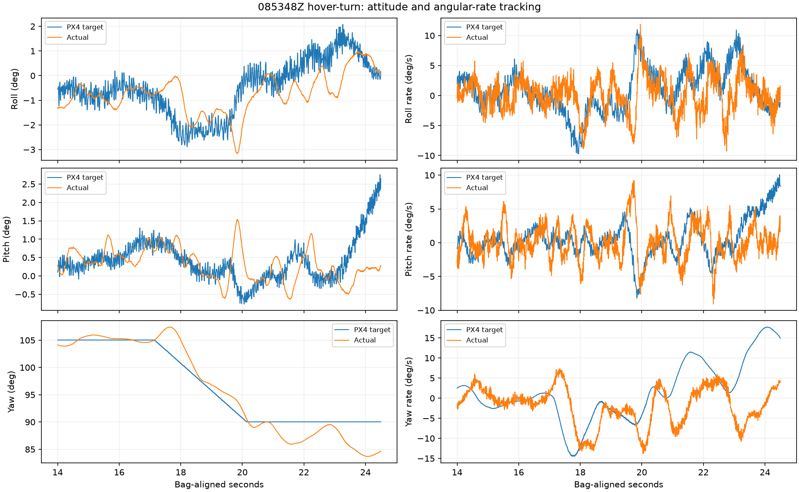
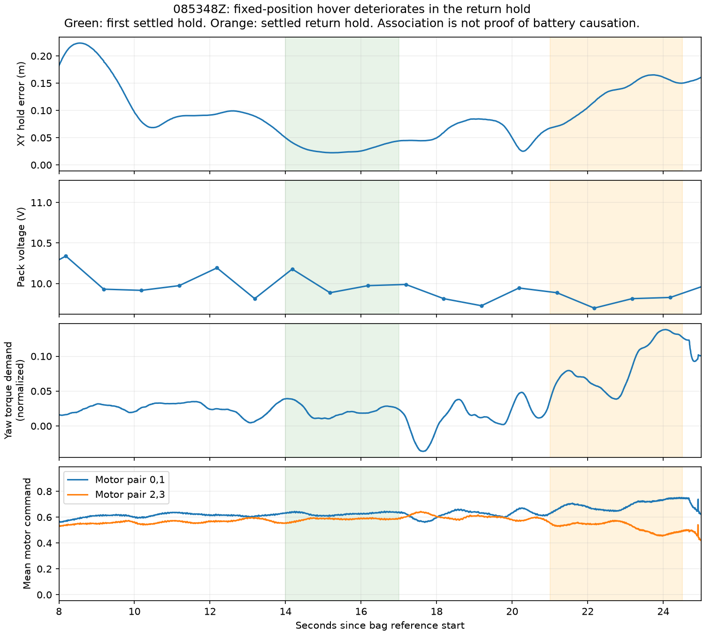

# Hover-turn diagnosis, 2026-09-07 08:53:48 UTC

**The open-area test reproduced a control-response problem with a fixed
horizontal setpoint.** The first settled hold was fairly good; the return hold
developed large rate-tracking errors and 16.5 cm of position error. The route
planner, path joins, horizontal feedforward, and tunnel geometry are not
required to produce this behavior. The earlier planner yaw slowdown remains
a mitigation, not a complete fix for the aircraft's tracking problem.

## Recording and execution

- `offboard_hold_yaw_20260907T085304Z` aborted before arming: no valid local
  position arrived within its 10 s startup window.
- `offboard_hold_yaw_20260907T085348Z` completed the requested sequence:
  arm 4.96 s, yaw out 9.60 s, first hold 12.09 s, yaw back 17.10 s, return
  hold 19.59 s, AUTO.LAND 24.60 s, disarmed/DONE 29.41 s. No tracking abort.
- Retrieved `/fs/microsd/log/2026-09-05/00_58_16.ulg` as
  `ros2_ws/flight_logs/px4_00_58_16.ulg`: **2,623,755 bytes, SD size matched,
  zero ULog dropouts**. All three new control topics are present.
- PX4 boot timestamps match the bag with an offset of **−137.808760224 s**.
  Comparisons between onboard topics use the onboard clock, not ROS receipt
  timing. Target samples are causal and no older than 50 ms.
- The successful bag's `metadata.yaml` is empty; analysis reads its MCAP
  directly. This does not prevent recovering the flight data.

The transmitted horizontal position stayed exactly constant during the
flight's hover/turn window. Both horizontal velocity and acceleration
feedforward were NaN. This is a position-hold test, not a test of the new
planner yaw-slowdown code.

## First hold versus return hold

Use **14–17 s** and **21–24.5 s**, after the respective heading ramps have
finished. This avoids labeling the last part of a yaw ramp as settled hover.

| Measured quantity | First settled hold | Settled return hold |
|---|---:|---:|
| Median XY position error | 2.75 cm | **13.80 cm** |
| Peak XY position error | 4.95 cm | **16.52 cm** |
| Peak horizontal speed | 0.058 m/s | **0.163 m/s** |
| Roll attitude error RMS | 0.50° | 1.08° |
| Pitch attitude error RMS | 0.36° | 0.98° |
| Yaw attitude error RMS | 0.61° | **3.89°** |
| Roll rate error RMS | 2.36°/s | 4.81°/s |
| Pitch rate error RMS | 2.47°/s | 4.28°/s |
| Yaw rate error RMS | 2.34°/s | **12.77°/s** |
| Mean demanded yaw rate | −0.09°/s | **+9.65°/s** |
| Mean measured yaw rate | +0.17°/s | **−1.36°/s** |
| Mean normalized yaw torque demand | +0.0215 | **+0.0843** |
| Mean command ratio, motor pair (0,1)/(2,3) | 1.074 | **1.321** |
| Highest motor command | 0.709 | 0.799 |

At about **24.0 s**, the heading target is stationary near 90.03°, actual
heading is about 83.75°, and the controller requests roughly **+17.5°/s** yaw
while actual yaw rate is about **−2.1°/s**. The problem is visible in the
attitude/rate cascade itself, not just in a comparison of the nose with the
route tangent. Roll and pitch also miss the requested corrections.



The motor commands do not hit their upper bound during these hover windows.
One motor reaches 1.0 for roughly 8 ms around **25.57 s**, during landing; that
does not explain the preceding hold deterioration. Commands below their ceiling
do not prove that motors/ESCs delivered the requested physical torque: RPM,
individual motor current, and ESC limiting are not recorded.

The increasing yaw torque and motor-pair difference demonstrate an increasing
**correction demand**. They do not by themselves prove a damaged propeller,
wrong motor direction, or a constant mechanical yaw bias. This short closed-loop
recording cannot uniquely separate a disturbance/imbalance, changing actuator
response, and inadequate rate-loop tuning.

## What looks healthy, and what remains uncertain

VIO retained **271 or more features** while airborne; the first and return
hold minima were 324 and 334. Body-VIO versus PX4 yaw disagreement was about
0.42° RMS in the first hold and 1.39° RMS in the return hold. There was no
recorded VIO reset sentinel. This provides no evidence of a gross yaw-frame
error or tracking dropout causing the event; it is not a proof of perfect
position estimation.

Peak altitude was 0.323 m against the 0.30 m request. Peak horizontal error
against the transmitted hold point was **0.224 m during climb**. The vehicle
was already moving when the altitude/position gate permitted the first yaw
leg: this existing test does not impose a timed initial hover dwell. That
does not account for the later deterioration after a good first settled hold.

The initial generic analysis prints a mean-roll-to-calibration heuristic.
**Do not infer a level-calibration error from it here.** This flight contains
translation, turns, and corrective tilt; the paired target/actual measurements
above are the relevant evidence.

## Power readings are a confound, not a proven cause

The user reports that the battery, motors, and props should be fine. No
hardware defect is assumed. The recorded power readings still need to be
accounted for:

| Window | Mean pack voltage | Lowest recorded pack voltage | Mean current |
|---|---:|---:|---:|
| Pre-takeoff, 4–7 s | 11.07 V | 10.95 V | 0.39 A |
| First settled hold, 14–17 s | 10.01 V | 9.89 V | 37.5 A |
| Return hold, 21–24.5 s | **9.81 V** | **9.70 V** | 38.2 A |

PX4 reports three cells, so the lowest pack reading corresponds to a **3.23 V
per-cell average**; individual cell voltages are unavailable. The earlier 73%
preparation reading was not the state at takeoff after the intervening restart.
The flight bag already reports LOW battery before arming, around 30% estimated
remaining near takeoff. SoC is an estimate; voltage is the primary observation
here, and its calibration has not been independently verified during this task.

The two wall-strike windows also had low recorded loaded voltages: about
10.22 V in 080022Z and 10.03 V in 080337Z. This makes power-dependent response
a possible shared contributor. It does **not** establish battery causation or
an ESC low-voltage cutoff. PX4's
[tuning guide](https://docs.px4.io/main/en/config_mc/pid_tuning_guide_multicopter)
notes that the PWM-to-thrust relationship depends strongly on battery voltage.



## Comparison with the successful historical yaw test

Read the actual parameters from the successful July 26 `px4_05_23_55.ulg`
and this new ULog. **MC attitude/rate gains and CA mixer parameters are
unchanged.** In particular, yaw I is already 0.10; the old recommendation to
raise it from 0.04 is obsolete and must not be repeated.

The older 45° test had almost balanced spin-pair commands (1.001 ratio), mean
yaw torque −0.0002, and mean collective command about 0.366. This 15° test's
airborne mean collective command is about 0.603, with growing yaw compensation.
This is evidence against a recent gain/mixer-setting regression, not proof
that the current physical vehicle or loading is identical to July's. Board-roll
calibration, hover-thrust initialization, battery-model parameters and auxiliary
PWM endpoints differ; MAIN motor PWM endpoints do not.

## Next fix to pursue

1. Establish a known power condition: repeat this same bounded test on a
   verified fully charged pack and cross-check the reported pack voltage with
   an independent reading. This tests the voltage hypothesis rather than
   declaring the battery defective. A healthy battery can still have been
   insufficiently charged for this run.
2. If the return hold still develops the same errors under that condition,
   work on **rate tracking and actuator response before more planner tuning**.
   The target/gyro pairs and motor demand are now recorded, so another test can
   be compared directly. The
   [PX4 rate-controller guide](https://docs.px4.io/main/en/config_mc/pid_tuning_guide_multicopter#rate-controller)
   explains why this innermost loop affects position hold in every flight mode.
   A gain change cannot be justified as the sole remedy for an unresolved
   changing torque requirement from this log alone.
3. Return to tunnel validation only after the fixed-position hold remains
   controlled through the return leg. Raising the yaw slew or weakening the
   planner hold would not repair the measured rate-tracking discrepancy.

No flight-control parameters or flight behavior were changed during this
analysis, and no additional flight was initiated.

## Reproduction and artifacts

```bash
.venv-mavlink/bin/python3 scripts/analyze_attitude_response.py \
  ros2_ws/flight_logs/px4_00_58_16.ulg \
  --time-offset=-137.808760224 \
  --window yaw_hold:14:17 --window return_hold:21:24.5 \
  --out reports/hover_turn_085348_control --plot
.venv-mavlink/bin/python3 -m unittest discover -s scripts \
  -p 'test_analyze_*response.py'
```

Four analysis regressions pass (causal timing, byte-valued validity flags,
quaternion normalization/cardinal axes, invalid attitude, and angle wrapping).
The `reports/hover_turn_085348_*` files retain the paired control CSV/JSON,
flight-window summary, battery and position samples, and both plots.

## Follow-up: full-battery repeat, 2026-09-07 09:31:57 UTC

The same sequence flown on a full pack (11.94 V rested, 92% remaining) tracked
the return hold 3.1x better: 4.4 cm median XY error and 4.96°/s yaw rate error
RMS, at 0.512 hover collective instead of 0.606. The yaw-lag signature analysed
above is still present on the full pack but is contained rather than divergent.
See [HOVER_TURN_BATTERY_COMPARE_20260907.md](HOVER_TURN_BATTERY_COMPARE_20260907.md).
