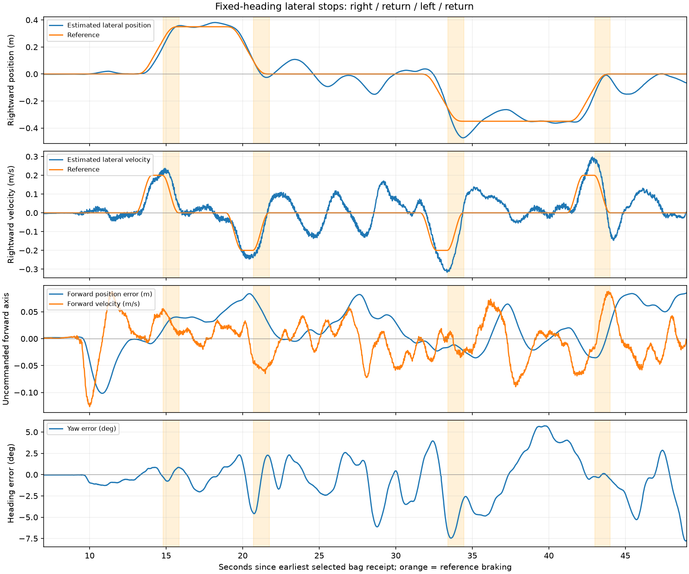
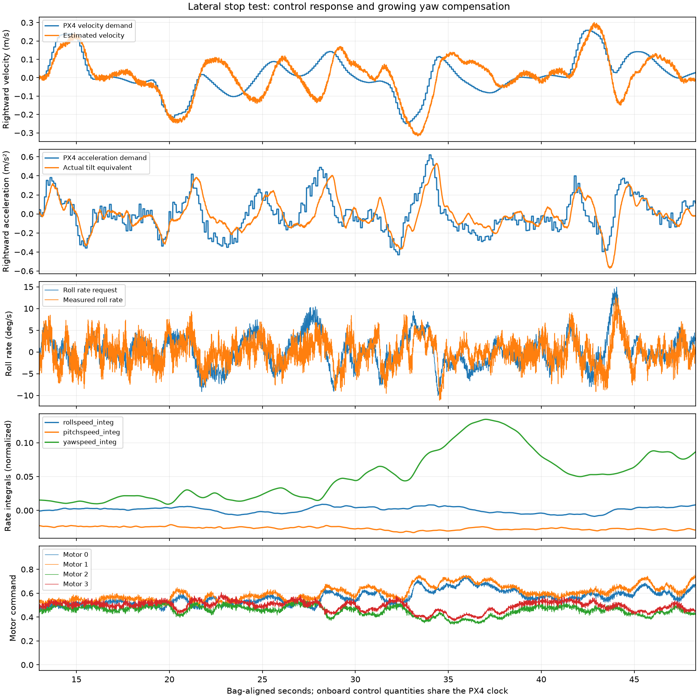

# Lateral-stop flight: braking overshoot and stationary-target oscillation

The open-area test reproduced substantial lateral tracking error with a fixed
heading, a smooth analytic reference and no planner/replanning inputs. It also
captured repeated excursions while the position target was completely stationary.
This establishes a control/estimation/airframe problem that planner geometry alone
cannot explain. It does not uniquely identify PID tuning or a defective motor.

## Recording and pairing

- ROS: `ros2_ws/flight_logs/offboard_lateral_stop_20260908T043031Z`, 52.395 s,
  31,211 messages, finalized metadata; one undecodable `/rosout` message.
- SD: `/fs/microsd/log/2026-09-05/20_22_29.ulg`, retrieved as
  `ros2_ws/flight_logs/px4_20_22_29.ulg`; **5,970,027 bytes**, matching SD size.
- ULog duration 44.405 s, with one **20 ms dropout at analysis t=7.684 s**, before
  lateral motion. New integral, allocator, battery and actuator-output topics
  are present; `esc_status` is absent, so RPM/delivered torque is unobserved.
- Analysis zero: host receipt timestamp `1788841833240776547` ns. PX4 boot time
  plus **-221.368546679 s** gives analysis time. 2,044 exact local-position
  timestamp matches between bag and ULog have zero x-coordinate difference.
- Firmware `d6f12ad1c4f70ad3230afd7d86e971421e02fef4`. No in-flight parameter
  changes; compared MC/MPC/EV/PWM/thrust settings match tunnel run 3.
- All four legs completed. Automatic LAND began 48.31 s, land commands 48.36 s;
  the user pressed K at 50.91 s during landing. The watchdog did not end the test.

## What happened at the stops

Every leg requested 0.20 m/s peak velocity and continuous acceleration with a
0.30 m/s² peak. Initial heading was about NED 90 degrees; signed lateral position
is along the fixed initial right axis, not the instantaneous body axis.

| Leg | Direction | Peak measured speed | Travel after reference braking starts, until first reversal | Initial endpoint overshoot | Subsequent hold duration |
|---|---|---:|---:|---:|---:|
| 1: right | Right | 0.237 m/s | 15.4 cm | 0.8 cm | 3.05 s |
| 2: return | Left | 0.247 m/s | 12.4 cm | 2.5 cm | 9.85 s |
| 3: left | Left | 0.316 m/s | 21.3 cm | 12.2 cm | 6.75 s |
| 4: return | Right | 0.298 m/s | 13.5 cm | 0 cm; first reversal short of target | 4.30 s |

First reversal occurs 1.24 / 0.92 / 0.97 / 0.79 s after the respective reference
braking markers. These are **not controller latency estimates**: the reference
deliberately brakes over about 1.047 s and the response is a closed-loop motion.
Travel comes from estimated position and includes estimator corrections; it is
not an externally measured or certified stopping-distance envelope.

After leg 2 initially stops, the stationary-target hold ranges from **+10.8 cm to
-15.0 cm** around its endpoint: approximately **25.8 cm peak-to-peak**. After leg
4, the aircraft moves back to about -14.9 cm despite having nearly reached zero.
Those later excursions must not be mislabeled as the initial braking overshoot.
The measured settling gate correctly waits before permitting the next leg.

During t=22–31.5 s, published XY position has exactly zero range and horizontal
velocity/acceleration feedforward are exactly zero. Yaw reference is constant
throughout the experiment. Maximum transit setpoint receipt gap is 64 ms. VIO
features stay at least 241 during t=13–48.3 s; local-position, velocity and attitude
reset counters stay constant. VIO position also exhibits the lateral excursions,
although this does not provide independent ground truth or rule out estimator
delay/error. No map/planner target motion is needed to reproduce the oscillation.

## What the onboard loops show

On leg 3, positive quantities below mean rightward, away from its leftward travel:

| Time | PX4 velocity demand | Measured velocity | Acceleration demand | Actual tilt-equivalent acceleration |
|---|---:|---:|---:|---:|
| 33.0 s | -0.235 m/s | -0.276 m/s | +0.096 m/s² | -0.157 m/s² |
| 33.4 s | -0.187 m/s | -0.312 m/s | +0.216 m/s² | +0.015 m/s² |
| 33.8 s | -0.084 m/s | -0.234 m/s | +0.519 m/s² | +0.301 m/s² |
| 34.0 s | -0.005 m/s | -0.167 m/s | +0.620 m/s² | +0.379 m/s² |

Braking feedback was already requested before the reference's BRAKE phase,
because the aircraft was exceeding requested velocity. Corrective tilt follows
late. These comparisons use one PX4 clock, not bag receipt pairing. The
tilt-equivalent acceleration assumes near-hover vertical thrust; it is not the
measured translational acceleration.

During the stationary hold at 28.0 s, PX4 requests rightward velocity +0.089 m/s
while the estimate is still leftward -0.120 m/s. Requested rightward acceleration
is +0.458 m/s², but actual tilt is equivalent to only +0.106 m/s² at that instant.
The same correction/response mismatch occurs without a moving reference.

The newly recorded allocator status reports `torque_setpoint_achieved=true` and
`thrust_setpoint_achieved=true` throughout the maneuver/hold windows; unallocated
torque is approximately zero. Motor commands peak at 0.753. Recorded PWM spans
1457–1695, 1486–1705, 1368–1543 and 1395–1587 microseconds for motors 0–3, inside
the configured 1100–1900 range. Thus no logged allocation/output clipping
explains the miss. These flags describe command allocation, **not physical motor
achievement** ([PX4 allocator message](https://docs.px4.io/main/en/msg_docs/ControlAllocatorStatus)).

## Growing yaw compensation despite constant heading

| Window | Roll-angle error RMS | Roll-rate error RMS | Yaw-rate error RMS | Mean published yaw torque |
|---|---:|---:|---:|---:|
| First leg/hold, 13–19 s | 0.60° | 3.08°/s | 3.31°/s | 0.016 |
| Second hold, 22–31.5 s | 1.03° | 4.00°/s | 8.58°/s | 0.040 |
| Third leg, 32–35 s | 1.21° | 3.67°/s | 15.16°/s | 0.095 |

Directly logged yaw integral rises from a first-window median of **0.0137** to a
peak of **0.1346** during t=31.65–41.2 s. Its configured limit is 0.30, so this
is not integrator saturation. Pitch integral remains around -0.02 to -0.03;
roll integral remains approximately within ±0.009.

Correspondingly, mean motor commands change from approximately
`[0.505, 0.544, 0.477, 0.507]` in the first window to
`[0.603, 0.655, 0.422, 0.455]` in the third-leg window. Motors 0/1 share one
configured yaw-moment sign and 2/3 the opposite sign. The growing split reflects
the controller's yaw correction; the split alone does not identify which motor
or component is responsible. During the third-leg window mean requested yaw rate
is +6.26°/s while measured mean is -2.25°/s.

Loaded-voltage medians from onboard windows fall approximately
11.05 → 10.88 → 10.78 → 10.70 V. These windows occur at different times and do not
isolate voltage, warming, direction, or load. The two leftward legs differ
substantially, so this single flight does not establish a fixed left/right bias.

## Implication for the tunnel failures and next action

The tunnel strike mechanism is now reproduced in open space: excess lateral
velocity, corrective tilt arriving late, and further excursions after the first
stop. A stationary HOLD does not guarantee that the aircraft stays within the
clearance envelope. The previous degraded-cap correction fixes a software defect,
but this experiment does not exercise that adapter and proves the remaining
problem can occur independently.

Do not treat increasing maximum acceleration/tilt/rate parameters as the next
fix. The priority is to resolve the growing yaw compensation and validate the
inner control response. Begin with a props-off inspection of prop type/rotation,
motor/arm alignment, mounts and drag, and review ESC/output calibration; the
recording does not justify declaring any particular component defective or
changing calibration blindly. Then assess rate-loop tuning with controlled
excitation and the same telemetry. PX4 describes the inner rate loop's effect on
position stability in its [tuning guide](https://docs.px4.io/main/en/config_mc/pid_tuning_guide_multicopter#rate-controller).

An estimator timing contribution also remains open; no independent position
ground truth was recorded. Avoid fitting one braking constant from these four
stops: repeatability is inadequate, and the late oscillations matter as much as
the first stop for indoor clearance. Planner stopping checks should ultimately
include actual velocity, response delay and tracking-error allowance calibrated
after the control response is corrected.

No flight-control code, PX4 parameters or live logging settings were changed in
this analysis. Offline extraction and plots are reproducible with
`scripts/analyze_lateral_stop.py` and `scripts/analyze_lateral_stop_onboard.py`.
Both scripts passed Python compilation, and `git diff --check` passes.
