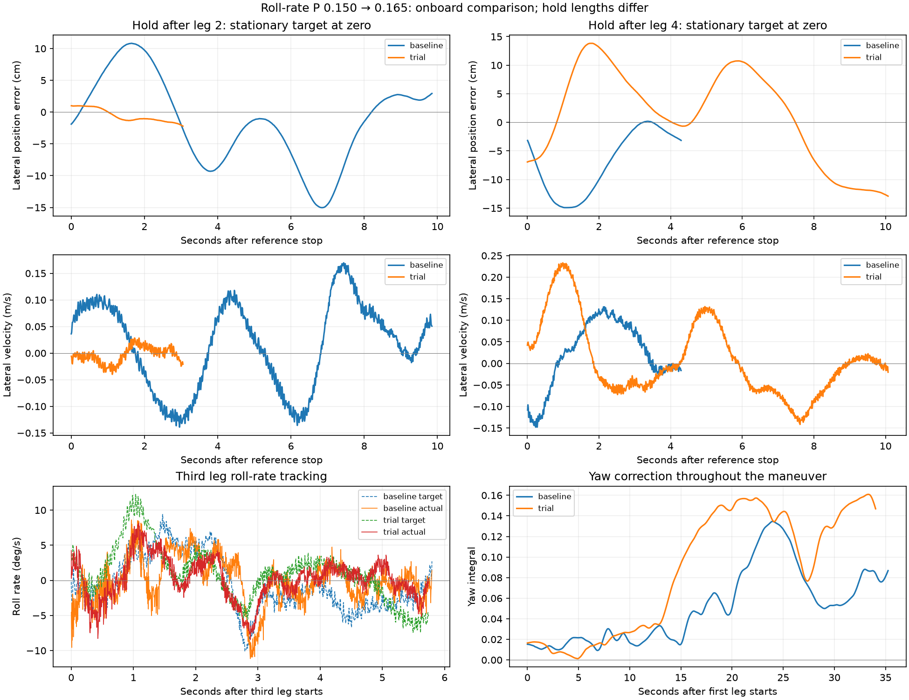

# Roll-P trial: mixed improvement, final hold remains unstable

The trial did not establish a usable fix for the tunnel failures. Roll-rate error
decreased during the four moving legs, and the second stop improved substantially,
but the third still overshot 11.6 cm and the final stationary hold spanned 26.7 cm.
Growing yaw compensation persists. **Restored MC_ROLLRATE_P from 0.165 to 0.150
over USB while disarmed**, with readback verified. No other parameter was written.
[Rollback evidence](../reports/roll_rate_p_rollback_20260908T050832Z.txt).

## Recordings and completeness

- First attempt: `offboard_lateral_stop_20260908T045941Z`, 15.450 s and 8,960
  messages. At t=4.608 s the node reported invalid/stale local position or velocity
  and requested LAND, before any lateral leg. It reached DONE at t=15.015 s.
  The recorder's local-position stream has no invalid XY/vXY flags and no receipt
  gap above 93 ms. This does not resolve what the flight node received or whether
  other validity checks failed. Do not classify this as a failed braking maneuver.
- Main trial: `offboard_lateral_stop_20260908T050015Z`. The 4,988,928-byte MCAP
  ends in a partial message at t≈34.52 s during leg 4; metadata.yaml is empty.
  Available data were extracted without modifying the original. Terminal logs
  also have incomplete tails, including zero-filled regions. Cause unconfirmed;
  the ROS tail cannot be reconstructed by simply reindexing this file.
- Complete onboard log: `/fs/microsd/log/2026-09-05/20_51_29.ulg`, downloaded as
  `ros2_ws/flight_logs/px4_20_51_29.ulg`, **5,897,019 bytes**, matching SD size.
  Duration 44.035 s; bag-aligned t=4.976–49.011 s. Boot-to-bag offset
  **-157.556976483 s**. There are 1,465 exact local-position timestamp matches
  with zero x-coordinate disagreement between ROS and SD.
- SD reports dropout entries of 0/0/33 ms at t=5.221 s and 73 ms at t=37.129 s.
  The latter affects the final hold. The broad multi-second excursions are
  recorded on both sides of that gap; it does not conceal the entire stop.
- ULog confirms P=0.165, no in-flight parameter changes, unchanged firmware and
  other MC/MPC/EV parameters. Accelerometer calibration offsets differ from the
  baseline: X -0.09084→-0.08419, Y +0.11419→+0.04696, Z -0.15311→-0.12756.
  This comparison does not establish why those offsets changed. They are an
  additional confound; this agent's tuning write changed only roll-rate P.

## Motion comparison, using onboard local position

Both flights use the same reference profile: 35 cm legs, 0.20 m/s peak, 0.30 m/s²
peak acceleration and fixed initial heading. Values below are baseline → trial.

| Leg | Peak moving speed, m/s | Initial endpoint overshoot, cm | Full hold lateral span, cm | Hold duration, s |
|---|---:|---:|---:|---:|
| 1, right | 0.237 → 0.216 | 0.8 → 0.0 | 3.6 → 6.7 | 3.05 → 3.30 |
| 2, return left | 0.247 → 0.213 | 2.5 → 0.0 | 25.8 → 3.2 | 9.85 → 3.05 |
| 3, left | 0.316 → 0.297 | 12.2 → 11.6 | 20.8 → 18.9 | 6.75 → 6.30 |
| 4, return right | 0.300 → 0.275 | 0.0 → 13.8 | 15.1 → 26.7 | 4.30 → ≈10.08 |

Zero initial overshoot can mean stopping short; it does not imply accurate
tracking. Hold spans have different observation lengths, so they are not a
controlled equal-duration measure of oscillation amplitude. The plot also shows
the common portions of the holds. Small differences from the earlier ROS table
reflect the denser onboard position sampling.

The surviving node log places the final LATERAL_HOLD transition at t=35.3798 s.
Onboard trajectory setpoints confirm the final target is constant with exactly
zero horizontal velocity/acceleration feedforward during t=35.4–45.4 s. Actual
lateral position ranges from **-12.9 to +13.8 cm** about the target. Horizontal
speed exceeds the 0.06 m/s settle threshold for approximately 71% of that window;
position exceeds 10 cm for 57%, and heading exceeds 5° for 25%. Altitude stays
inside its gate. Onboard simultaneous position/speed/altitude/yaw pass intervals
last at most about 0.24 s, below the required continuous 1 s.

LAND is commanded at t=45.455 s; PX4 enters AUTO.LAND at t=45.469 s, with no
PX4 failsafe flag. This timing is consistent with the ten-second settling timeout.
The missing ROS tail prevents directly reading the node's landing reason. The
user reports pressing K, matching the external force-disarm command at
t=48.008 s, about 2.5 s after PX4 entered landing mode.
The recording cutoff at t=34.52 s is therefore not evidence that flight control
stopped at that time.

## Did roll response improve?

| Moving leg | Roll-rate tracking error RMS, baseline → trial (°/s) |
|---|---:|
| 1 | 3.09 → 2.67 |
| 2 | 3.11 → 2.35 |
| 3 | 3.70 → 3.38 |
| 4 | 4.85 → 3.51 |

Combined sample-weighted moving-leg RMS is 3.75→3.02°/s, about 20% lower. This is
encouraging but not causal proof of a better tune: feedback rate demands differ,
especially on leg 2. Leg 3 roll-angle RMS actually changes from 1.14 to 1.24°.
During the first three seconds of the final hold, roll-rate error worsens from
2.71 to 4.82°/s and roll-angle error from 0.92 to 1.41°. That phase also requests
more roll motion, so it cannot isolate rate-loop quality either.

## Yaw compensation and actuator allocation

Peak yaw integral increases **0.135 → 0.161**, remaining below its 0.30 limit.
Final-hold mean motor commands are approximately:

- Baseline: `[0.608, 0.658, 0.438, 0.469]`.
- Trial: `[0.651, 0.695, 0.392, 0.418]`.

The same two yaw-moment groups separate further. Final-hold yaw-rate error RMS
is 9.33→13.05°/s; trial heading error reaches about 8.3°. Allocator thrust/torque
achievement flags remain true throughout evaluated windows, and trial motor
commands peak at 0.773. Command allocation is not measured motor achievement;
ESC/RPM telemetry is absent. The evidence still does not identify a faulty motor
or prove that increasing roll P caused the greater yaw correction.

The trial's final hold has a loaded-voltage median of about 10.84 V versus 10.67 V
in the baseline final hold. This rules out a simple description that the worse
trial hold just had lower recorded voltage; it does not characterize battery or
propulsion health. XY, horizontal-velocity and quaternion reset counters remain
constant through the main trial maneuver/holds. ROS VIO features remain at least
254 until its recording ends; health after that cutoff is not available from ROS.

## Decision and next diagnostic

The single gain increase shows some rate-tracking benefit but fails the overall
stopping/holding acceptance criterion. Return to baseline rather than stacking
another gain change on a confounded result. The restoration is a conservative
experimental decision, not a finding that P=0.165 caused the failure.

Investigate the growing yaw correction with the propulsion configuration and
actual motor response before selecting another tuning change. Motor/prop
direction, mounting/alignment and available ESC diagnostics are concrete checks;
the July motor-direction fault was corrected then and cannot be assumed to have
recurred. Estimator timing remains an open contributor. Neither tested gain
supports tight tunnel clearance yet.

For subsequent recordings, let the flight launch exit and the recorder finalize
before removing companion power. The current unfinalized bag remains preserved.

Reproduce the analysis with `.venv-mavlink/bin/python3
scripts/compare_lateral_tuning_20260908.py`. It reads the extracted ROS JSON and
both ULogs, writes `reports/lateral_tuning_comparison.json/.txt/.png` (redirect
stdout to obtain the `.txt`), and explicitly supplies the recovered leg-4 timing.
It has no live vehicle connection or control writes.
